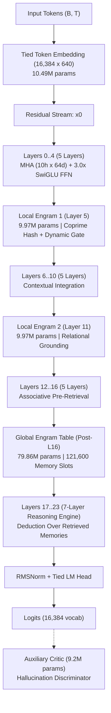

# TinyTransformer: 238M Engram-Hybrid Transformer with Muon & Adversarial RL

[](https://colab.research.google.com/github/logicstillloading/TinyTransformer/blob/main/TinyTransformer_Colab_T4.ipynb)
[](https://pytorch.org)
[](https://python.org)
[](LICENSE)

A high-throughput **~237.8M parameter** language model engineered with **Reasoning-After-Retrieval** Engram memory tables, **Keller Jordan's Muon optimizer** (5th-order Newton-Schulz polar orthogonalization), and an auxiliary **Adversarial Critic RL discriminator** for hallucination suppression.

---

## ⚡ 1. Train on Google Colab (Tesla T4 GPU)

Click the badge above or open [`TinyTransformer_Colab_T4.ipynb`](file:///d:/TinyTransformer/TinyTransformer_Colab_T4.ipynb) to launch high-speed training on Google Colab's free or Pro T4 GPU.

### T4 Throughput & Speed Optimization:
- **Hardware FP16 Tensor Cores (130 TFLOPs)**: Tesla T4 (Turing `sm_75`) does not have native hardware BF16. Training automatically engages hardware FP16 mixed precision paired with PyTorch's `GradScaler`, unlocking **4x-5x higher tokens/second** than BF16 CPU emulation.
- **16 GB VRAM Saturation**: Micro-batch size 4 (or 8) with gradient accumulation 8 gives **32,768 tokens/step** with high parallel core utilization.
- **Continuous Google Drive Sync**: Atomic checkpoints (`checkpoint_latest.pt`, `checkpoint_prev.pt`, and milestone archives) save directly into Google Drive (`/content/drive/MyDrive/TinyTransformer/checkpoints`), so **zero progress is lost** across disconnections.

---

## 🏗️ 2. Architectural Specification (~237.8M Parameters)



### Parameter Breakdown:
- **Total Parameters**: 237.85M (237,847,040 unique parameters)
- **Dense Transformer Backbone**: 138.31M parameters (24 layers, hidden dim 640, 10 attention heads, SwiGLU 3.0x multiplier = 1920 intermediate dim)
- **Engram Memory System**: 99.54M parameters
  - Global Engram (post-Layer 16): 79.86M params (1,900 clusters x 64 slots x 640 dim)
  - Local Engram 1 (Layer 5): 9.97M params (220 clusters x 64 slots x 640 dim)
  - Local Engram 2 (Layer 11): 9.97M params (220 clusters x 64 slots x 640 dim)
- **Auxiliary Critic RL Model**: 9.2M parameter discriminator (dormant during foundation pretraining, activates during phase 2)

---

## 🚀 3. Quick Start & Training Commands

### Installation
```bash
git clone https://github.com/logicstillloading/TinyTransformer.git
cd TinyTransformer
pip install -r requirements.txt
```

### Pretraining Commands
* **Auto-Optimized Pretraining (Colab / T4 / A100 / RTX)**:
  ```bash
  python train.py --batch-size 4 --grad-accum 8 --dtype auto --resume
  ```

* **Local Consumer GPU (RTX 3050 Ti Laptop / 4.3 GB VRAM)**:
  ```bash
  python train.py --batch-size 1 --grad-accum 32 --dtype auto --resume
  ```

* **Phase 2 Pretraining with Auxiliary Adversarial Critic RL**:
  ```bash
  python train.py --batch-size 4 --grad-accum 8 --enable-critic --critic-loss-target 2.7 --resume
  ```

---

## 🕹️ 4. Safe Remote Control Flags (Zero Lost Tokens)

Control running training runs safely by creating empty flag files:

* **Graceful Stop & Save** (Finishes current step, saves `checkpoint_latest.pt`, exits cleanly):
  ```bash
  touch stop.flag        # Linux / Colab
  type nul > stop.flag   # Windows CMD
  ```

* **Immediate Snapshot Without Stopping**:
  ```bash
  touch save.flag        # Linux / Colab
  type nul > save.flag   # Windows CMD
  ```

* **Clear Active Flags**:
  ```bash
  rm -f stop.flag save.flag critic.flag   # Linux / Colab
  del stop.flag save.flag critic.flag     # Windows
  ```

---

## 🧪 5. Evaluation & Factual Probes

Evaluate checkpoints directly on GPU or CPU without interrupting training:

```bash
# Run factual probes & generation previews
python test.py --checkpoint checkpoints/checkpoint_latest.pt --device cuda

# Greedy argmax generation
python test.py --checkpoint checkpoints/checkpoint_latest.pt --device cuda --greedy
```

---

## 📊 6. Plotting Training Progress

Generate multi-panel loss, perplexity, and throughput plots:
```bash
python plot_metrics.py --log-dir logs
```

---

## 🛡️ License

MIT License. Designed and built with Keller Jordan's Muon optimizer and Reasoning-After-Retrieval architecture.
