# Architecture Specification: TinyTransformer-238M (Engram-Hybrid-RL)

Comprehensive architectural design document, mathematical parameter derivations, tensor layouts, operational dynamics, strengths, and failure modes for the ~237.8M parameter TinyTransformer suite on the NVIDIA GeForce RTX 3050 Ti Laptop GPU (4.1 GB GDDR6).

---

## 1. Information Flow Architecture: Reasoning-After-Retrieval

```mermaid
flowchart TD
    subgraph Input_Stage ["1. Input Embedding"]
        Tokens["Input Tokens (B, T)"] --> Embed["Tied Token Embedding (16,384 x 640)<br/>10.49M params (FP32 Master)"]
        Embed --> Resid0["Residual Stream: x0 (B, T, 640)"]
    end

    subgraph Early_Blocks ["2. Early Syntactic Layers (L0..L4)"]
        Resid0 --> Blocks0_4["Transformer Blocks 0 to 4 (5 Layers)<br/>MHA (10h x 64d) + 3.0x SwiGLU FFN<br/>28.8M params"]
        Blocks0_4 --> Resid1["Residual Stream: x1 (B, T, 640)"]
    end

    subgraph Local_Engram_1 ["3. Early Semantic Grounding"]
        Resid1 --> Engram1["Local Engram Table 1 (Layer 5)<br/>220 clusters x 64 slots x 640 = 9.97M params<br/>Coprime Hash EmbeddingBag + SiLU + Dynamic Gate"]
        Engram1 --> Add1["Residual Add: x1 + gate1 * out1"]
    end

    subgraph Mid_Blocks ["4. Contextual Integration Layers (L6..L10)"]
        Add1 --> Blocks6_10["Transformer Blocks 6 to 10 (5 Layers)<br/>MHA (10h x 64d) + 3.0x SwiGLU FFN<br/>28.8M params"]
        Blocks6_10 --> Resid2["Residual Stream: x2 (B, T, 640)"]
    end

    subgraph Local_Engram_2 ["5. Mid-Level Synthesis"]
        Resid2 --> Engram2["Local Engram Table 2 (Layer 11)<br/>220 clusters x 64 slots x 640 = 9.97M params<br/>Coprime Hash EmbeddingBag + SiLU + Dynamic Gate"]
        Engram2 --> Add2["Residual Add: x2 + gate2 * out2"]
    end

    subgraph Deep_Blocks ["6. Associative Pre-Retrieval Layers (L12..L16)"]
        Add2 --> Blocks12_16["Transformer Blocks 12 to 16 (5 Layers)<br/>MHA (10h x 64d) + 3.0x SwiGLU FFN<br/>28.8M params"]
        Blocks12_16 --> Resid3["Residual Stream: x3 (B, T, 640)"]
    end

    subgraph Global_Engram_Table ["7. Deep World Memory Retrieval"]
        Resid3 --> GlobalEngram["Global Engram Table (Post-Layer 16)<br/>1,900 clusters x 64 slots x 640 = 79.86M params<br/>Coprime Hash EmbeddingBag + SiLU + Dynamic Gate"]
        GlobalEngram --> Add3["Residual Add: x3 + gate_global * out_global"]
    end

    subgraph Reasoning_Blocks ["8. Post-Retrieval Reasoning Layers (L17..L23)"]
        Add3 --> Blocks17_23["Transformer Blocks 17 to 23 (7 Layers)<br/>Reasoning, Deduction & Multi-step Induction<br/>Over Retrieved 80M Long-Term Memories!<br/>40.3M params"]
        Blocks17_23 --> ResidFinal["Enriched Representation (B, T, 640)"]
    end

    subgraph Output_Stage ["9. Output Projection & Loss"]
        ResidFinal --> FinalNorm["Final RMSNorm (640)"]
        FinalNorm --> LMHead["Tied LM Head Linear (640 -> 16,384)"]
        LMHead --> Logits["Generator Logits (B, T, 16,384)"]
        Logits --> FP32CE["FP32 High-Precision Cross-Entropy Loss"]
    end

    subgraph Auxiliary_Critic ["10. Optional Adversarial BS-Detector"]
        Logits -.-> Gumbel["Differentiable Gumbel-Softmax Sampling (Detached Weights)"]
        Gumbel -.-> Critic["Auxiliary Critic (9.0M params)<br/>Dormant until Threshold / Flag"]
        Critic -.-> AdvBonus["Adversarial RL Reward"]
    end
```

---

## 2. Reasoning-After-Retrieval Dynamic

In the **Reasoning-After-Retrieval** layout:
1. **Layers 0..4**: Extract low-level syntactic primitives and local phrase structures.
2. **Layer 5 (10M Local Engram 1)**: Injects early lexical associations and n-gram representations.
3. **Layers 6..10**: Synthesizes lexical facts with sequence-level syntactic context.
4. **Layer 11 (10M Local Engram 2)**: Injects relational knowledge and domain-specific patterns.
5. **Layers 12..16**: Integrates facts and structures representations for world knowledge lookup.
6. **Post-Layer 16 (80M Global Engram)**: Retrieves stationary world knowledge from 121,600 memory slots.
7. **Layers 17..23 (The 7-Layer Reasoning Engine)**: 7 full Transformer blocks perform multi-head attention and SwiGLU deduction *over the retrieved facts*, enabling multi-step logical reasoning before projecting to output logits.

---

## 3. Parameter Derivations & Tensor Layouts ($d = 640, d_{ff} = 1920, L = 24$)

### 3.1 Individual Transformer Layer Breakdown
1. **Multi-Head Attention (640 Dim, 10 Heads x 64 Dim)**:
   - Query Projection $W_q \in \mathbb{R}^{640 \times 640}$: $409,600$
   - Key Projection $W_k \in \mathbb{R}^{640 \times 640}$: $409,600$
   - Value Projection $W_v \in \mathbb{R}^{640 \times 640}$: $409,600$
   - Output Projection $W_o \in \mathbb{R}^{640 \times 640}$: $409,600$
   - *Subtotal Attention per Layer*: **1,638,400 parameters**

2. **SwiGLU Feed-Forward Network ($3.0\times$ Multiplier)**:
   - Intermediate dimension: $d_{ff} = 1920$
   - Gate Projection $W_{gate} \in \mathbb{R}^{1920 \times 640}$: $1,228,800$ (Trained by Muon)
   - Up Projection $W_{up} \in \mathbb{R}^{1920 \times 640}$: $1,228,800$ (Trained by Muon)
   - Down Projection $W_{down} \in \mathbb{R}^{640 \times 1920}$: $1,228,800$ (Trained by Muon)
   - *Subtotal FFN per Layer*: **3,686,400 parameters**

3. **Layer Normalizations**:
   - Pre-Attn RMSNorm: $640$
   - Pre-FFN RMSNorm: $640$
   - *Subtotal Norms per Layer*: **1,280 parameters**

**Total Per Layer**: $1,638,400 + 3,686,400 + 1,280 = \mathbf{5,326,080}$ parameters.  
**Total Across 24 Layers (Backbone Linear + Norms)**: $24 \times 5,326,080 = \mathbf{127,825,920}$ parameters.

---

### 3.2 Engram Sparse Memory Tables (~99.8M Total)

| Table | Clusters ($C$) | Slots/Cluster ($S$) | Total Slots ($C \times S$) | Memory Table ($M \times 640$) | Projections & Gating | Total Params |
|---|---|---|---|---|---|---|
| **Local Table 1 (Layer 5)** | 220 | 64 | 14,080 | 9,011,200 | 954,240 | **9.97M** |
| **Local Table 2 (Layer 11)** | 220 | 64 | 14,080 | 9,011,200 | 954,240 | **9.97M** |
| **Global Table (Layer 16)** | 1,900 | 64 | 121,600 | 77,824,000 | 954,240 | **79.86M** |
| **Total Engrams** | **2,340** | **64** | **149,760 slots** | **95,846,400** | **2,862,720** | **~99.80M** |

---

### 3.3 Optimizer Workload Partitioning

| Optimizer | Targeted Parameter Subsets | Total Parameters | Effective LR / Behavior |
|---|---|---|---|
| **Muon** | All 2D Linear weight matrices: MHA ($W_q, W_k, W_v, W_o$) and SwiGLU FFN ($W_{gate}, W_{up}, W_{down}$) | **130.25M** | LR = 0.02, Keller Jordan aspect ratio scaling $\max(1, d_{out}/d_{in})^{0.5}$, 5th-order Newton-Schulz orthogonal updates, weight decay = 0.01 |
| **AdamW** | Tied token embeddings ($16,384 \times 640$), stationary Engram memory tables ($149,760 \times 640$), RMSNorms, and dynamic gating projections | **107.60M** | LR = 3e-4, $\beta_1=0.9, \beta_2=0.95$ (decayed embeds, weight decay = 0.01), $\beta_2=0.999$ for stationary sparse memory tables (weight decay = 0.0) |
| **Critic AdamW** | 4-layer auxiliary Critic discriminator | **9.00M** | LR = 1e-4, dormant until threshold/flag |

---

## 4. Hardware Scaling & VRAM Budgeting (RTX 3050 Ti Laptop GPU)

- **Physical VRAM**: 4,096 MiB GDDR6 (GA107 die)
- **Hard Usable PyTorch Limit**: **~3,650 MiB**
- **Gradient Checkpointing Policy**:
  - Checkpoint all even layers (`idx % 2 == 0`) AND all Engram layers (`layer.has_engram` and `global_engram`).
  - Guarantees activation memory stays safely below 2.2 GB VRAM during backward pass while maintaining maximum throughput.

---

## 5. Dataset Mixture (6 Streams)

Pretraining draws continuously from 6 interleaved streams:
1. **Cosmopedia v2** (35%): Synthetic textbooks, stories, and educational articles.
2. **FineWeb-Edu Dedup** (30%): High-quality educational web content.
3. **FineMath 4+** (15%): Step-by-step mathematical reasoning.
4. **Python-Edu** (10%): Cleaned algorithmic and systems Python source code.
5. **Wikipedia (en)** (5%): Encyclopedic factual grounding.
6. **Instruction** (5%): Multi-turn conversational instruction tuning.
